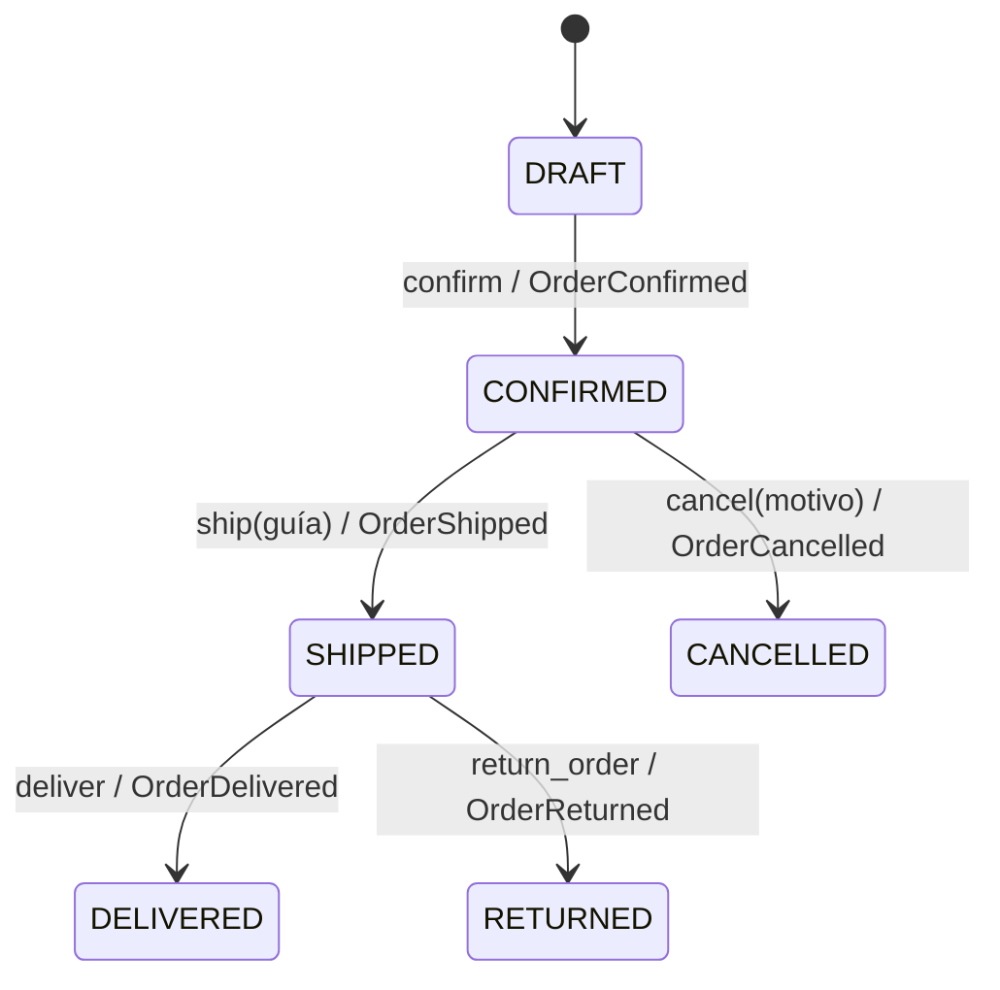

# Máquina de estados y Domain Events

## Eventos

| Evento | Transición | Cuándo se publica |
|---|---|---|
| `OrderConfirmed` | DRAFT → CONFIRMED | Pedido con artículos y cliente activo |
| `OrderShipped` | CONFIRMED → SHIPPED | Guía no vacía |
| `OrderCancelled` | CONFIRMED → CANCELLED | Motivo no vacío |
| `OrderDelivered` | SHIPPED → DELIVERED | Entrega válida |
| `OrderReturned` | SHIPPED → RETURNED | Devolución válida |

El método de dominio valida primero, muta el estado después y agrega el evento al final. Una excepción implica que estado y lista de eventos permanecen sin cambios.
